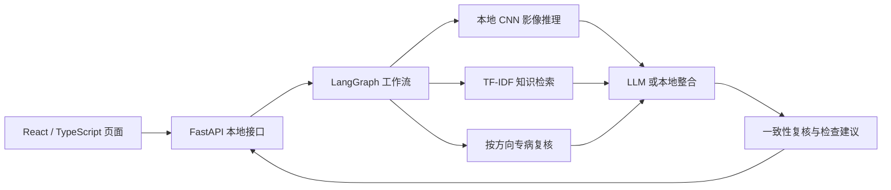

# 肺部异常辅助筛查与分诊系统

基于 React + TypeScript、FastAPI 和 LangGraph 的 Web 原型，将结构化问诊、胸片三分类、轻量知识检索、专病复核与可选 DeepSeek 综合说明整合到同一流程。用于演示与辅助筛查，不替代医生诊断。

本仓库是现有项目的结构规范化版本，保留原功能、页面布局和本地筛查规则。团队信息、远程仓库和历史补证尚未完成；当前文件不代表已通过全部参赛资格审核。

## 主要功能

- 结构化问诊、自定义病程与痰液描述，支持补充症状原文。
- PNG/JPG/JPEG 胸片输入，支持无影像的原有问诊路径。
- EfficientNetV2-S 三分类，提供 DenseNet121 替代权重。
- TF-IDF 知识摘要召回、按证据路由、专病规则/可选模型复核及有限反馈。
- 可选 DeepSeek 整合；无密钥、请求失败或输出格式无效时回退到本地决策。
- 展示风险、依据、检查建议、RAG 证据、Agent 轨迹、专病复核和结构化数据。

## 演示视频

[查看或下载演示视频](media/demo.mp4)（MP4，1920×1080，约4分33秒）。视频按提供的原文件上传，没有剪辑或补帧。文件通过Git LFS保存；如果GitHub页面无法直接播放，可选择下载，或克隆后执行 `git lfs pull`。录制使用此前界面，当前React版本保留原有布局与流程，技术实现以当前代码和技术文档为准。

## 技术架构



前端经同源 `/api/screen` 提交问诊和可选图像；后端继续调用原工作流。默认模型与知识检索在本机运行，原始影像不发送给云端 LLM。实现边界见 [架构说明](docs/architecture.md)。

## 仓库结构

```text
lung-screening/
├── backend/                 # Python API、原工作流与保留的 Streamlit 页面
├── frontend/                # React、TypeScript、Vite；包含 package-lock.json
├── models/                  # 两套本地权重、清单及说明；.pth 使用 Git LFS
├── examples/                # 六组演示影像和建议输入
├── scripts/                 # 环境检查、测试、评测和验证入口
├── tests/                   # 接口、迁移一致性、配置和评测保护测试
├── docs/                    # 架构、环境、开发、历史、来源及证据
├── .github/workflows/ci.yml # GitHub 自动检查配置
├── .streamlit/              # 原版界面的主题配置
├── .env.example             # 环境变量模板，复制为根目录 .env
├── requirements.txt         # 本机验证的 Python 直接依赖固定版本
├── requirements-dev.txt     # 测试与代码检查依赖
├── pyproject.toml           # Python 格式与检查规则
└── run.py                   # 跨目录启动入口；Windows 可用 run.bat
```

## 安装与运行

建议 Python **3.12**、Node.js **22.12+ 或 24+**、Git 和 Git LFS。本机验证环境为 Windows 64 位；其他平台需另外验收。以下命令从仓库根目录执行。

### 1. 获取仓库及模型

从实际 GitHub/Gitee 仓库克隆后运行：

```shell
git lfs install --local
git lfs pull
```

模型文件应为实际二进制，而非几行 LFS 指针。权重位置和哈希见 [模型说明](models/README.md)。远程平台须支持所需 LFS 配额并允许评审拉取；仓库访问权限与模型访问权限均需核验。

### 2. 安装 Python 依赖

Windows PowerShell：

```powershell
python -m venv .venv
.\.venv\Scripts\python.exe -m pip install -r requirements.txt
Copy-Item .env.example .env
```

macOS/Linux 的对应命令：

```shell
python3 -m venv .venv
.venv/bin/python -m pip install -r requirements.txt
cp .env.example .env
```

`.env` 可保持密钥为空，使用本地模式。启用 DeepSeek 时只在私有本机填写 `DEEPSEEK_API_KEY`。参数、默认值和优先级见 [环境说明](docs/environment.md)。不要把真实 `.env`、API 密钥或病例数据上传到仓库。

### 3. 构建前端

```shell
cd frontend
npm ci
npm run build
cd ..
```

构建产物 `frontend/dist` 不作为源码追踪，克隆后须执行这一步。本地已有 dist 时使用无需 Node.js；首次安装和构建需要联网。

### 4. 检查并启动

Windows：

```powershell
.\.venv\Scripts\python.exe run.py --check
.\.venv\Scripts\python.exe run.py
```

macOS/Linux：

```shell
.venv/bin/python run.py --check
.venv/bin/python run.py
```

访问 **http://127.0.0.1:8502**。Windows 也可双击 `run.bat`，脚本优先使用根目录 `.venv`。按 Ctrl+C 停止。端口被占用时使用 `python run.py --port 8503`。

原 Streamlit 界面仍可用：`python run.py --legacy`，或双击 `run-legacy.bat`。同一端口只能运行一个服务。

## 开发与验证

在已激活虚拟环境中执行：

```shell
python -m pip install -r requirements-dev.txt
python -m ruff check .
python -m ruff format --check .
python scripts/test.py
python scripts/test.py --models
```

默认测试不下载权重、不调用收费 API，跳过真实 CNN 一致性检查；`--models` 使用两套已下载权重并验收六组演示样例及无图像路径。运行输出写入被忽略的 `artifacts/`，不会覆盖 `docs/evidence/` 中已保存的记录。

前端检查和开发：

```shell
cd frontend
npm run format:check
npm run build
npm run dev
```

开发前先在另一终端启动 Python API（`python run.py`）；Vite 将 `/api` 代理到本机 8502。贡献流程、注释要求和测试分层见 [CONTRIBUTING.md](CONTRIBUTING.md)。GitHub CI 已提供配置，由平台在推送后触发；执行状态以仓库Checks为准，不把本地检查当作远程CI成功。

## 实验记录与能力限制

参赛技术文档见 [technical-report.pdf](docs/technical-report.pdf)，共17页，覆盖项目概述、需求分析、系统架构、AI方案、核心功能、测试部署、创新点与总结展望。其内容由原“肺智瞳”研究报告改编，正文源文件为 [technical-report.md](docs/technical-report.md)，改编与要求对照见 [改编说明](docs/technical-report-adaptation.md)。

- 已完成的本地记录见 [证据索引](docs/evidence/README.md)：前端迁移一致性、一次 DeepSeek 虚构输入调用、异常回退、六图两模型对比和检索功能消融。
- 六张图为精选演示样例，不是独立临床测试集；旧材料中的准确率提升数字仍缺少原始日志支持。
- 独立评测入口为 `scripts/evaluate_dataset.py`，数据要求见 [评测说明](docs/evaluation.md)。
- 当前 Agent 主要是规则驱动的多节点工作流，知识库为四条摘要；不宣称已实现自主规划、MCP 或临床有效性。
- 在线专病模型权重不包含在本仓库；无缓存时使用原有规则复核。模型权重、样例影像和第三方资源的授权核验边界见 [资源说明](docs/resources.md)。

## 团队信息

按当前约定暂不填写具体身份。**以下内容是正式提交前必须补齐的项目，不得将“待填写”作为最终团队信息提交。**

| 项目 | 内容 |
| --- | --- |
| 项目/队伍名称 | 肺部异常辅助筛查与分诊系统 / 队伍名称待填写 |
| 学校、学院、参赛组别 | 待填写并核实 |
| 成员与职责 | 待填写：成员姓名、职责、实际贡献 |
| 指导教师 | 待填写；没有则明确写“无” |
| GitHub 仓库地址 | https://github.com/RelseiLover/lung-screening；参赛时须Public或提供评审访问权限 |

## Git 历史与提交要求

当前是从无 `.git` 历史的本地交付目录整理出的源码版本，**没有历史提交可供保留**。首次导入记录当前整理后的原型，不代表过去的完整开发过程。后续应保留每次真实开发的提交；如找回原开发仓库，优先在原历史上整理，不能用回填日期或拆分导入文件来冒充过去的开发记录。

操作及验收项见 [仓库提交指南](docs/repository-submission.md) 和 [历史说明](docs/development-history.md)。

## 数据与许可

仅使用脱敏且已授权的演示数据。启用云端 LLM 会发送症状和派生证据；默认仅监听本机。临时图像在处理结束后清理，强制终止仍可能遗留文件。本项目尚未指定整体开源许可证；不要擅自将第三方权重或影像标为团队原创。已收集的软件许可见 [docs/licenses](docs/licenses/许可索引.json)，不等于完成全部资源的权利核验。
